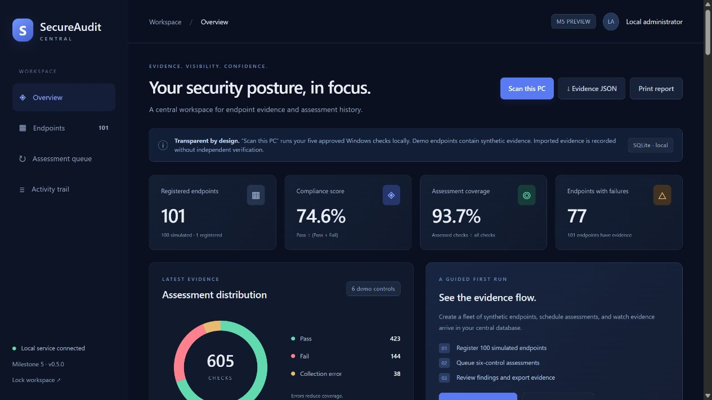

# SecureAudit

Windows security configuration assessment and local audit-evidence reporting.

## v0.6.0-beta release candidate

This candidate combines the Central dashboard with the local scanner, evidence-integrity checks, and research reporting work committed after v0.5.0-beta. It remains a beta application. The source and Windows package are prepared by the **Windows release candidate** workflow. Download its artifacts from [Actions](https://github.com/shr3y11/SecureAudit/actions); published versions appear under [Releases](https://github.com/shr3y11/SecureAudit/releases).

**Current packaging prerequisite:** owner catalog signing material is absent. The source candidate is downloadable; the Windows ZIP is available only after the owner completes the [signing step](docs/RELEASE_GUIDE.md#required-owner-catalog-signing-before-a-windows-build) and packaged startup verification passes.

### Windows quick start (after the Windows build passes)

1. Download `SecureAudit-v0.6.0-beta-Windows-x64.zip`.
2. Extract the entire ZIP to a writable folder.
3. Open `SecureAudit-v0.6.0-beta` and launch `SecureAuditCentral.exe`.
4. Keep the launcher open while using the browser dashboard.
5. Use **Scan this PC** to run the five approved checks on this computer. Use **Run as administrator** when elevated collection is needed.

Keep every file in the extracted folder together. The portable package includes Python and dependencies; no separate Python installation is needed. It uses the original Python interpreter executable renamed as the launcher. A vendor signature on that interpreter does not sign SecureAudit's bundled application code. The build records the interpreter's signature status.

Read the [release guide](docs/RELEASE_GUIDE.md) before upgrading and the [release notes](RELEASE_NOTES.md) for scope and limitations.



## What is implemented

| Component | Capability |
| --- | --- |
| Windows scanner | Approved PowerShell modules for Firewall, Defender, OS-drive BitLocker, built-in Guest account and SMBv1 |
| Local desktop | Tkinter checklist, selected-only execution, administrator elevation, SQLite history and standalone HTML reports |
| Central dashboard | Local FastAPI service, endpoint inventory, evidence history, trends, JSON/CSV export and browser printing |
| Evidence ingestion | Strict input schema and duplicate-submission handling; imported evidence is labelled as imported |
| Integrity checks | Payload digest and metadata consistency checks; detected inconsistencies withhold affected scores |
| Demo mode | Synthetic fleet and persistent assessment queue, explicitly separated from real local scans |
| Storage | Local SQLite by default; optional externally provisioned PostgreSQL |
| Research extension | Fixed-baseline coverage, complete-pass-fraction bounds and threshold stability in the local desktop HTML workflow |

The portable Central launcher and the original desktop are different entry points. Central is started with `launcher.py`; the original checklist/HTML workflow uses `app.py` from the source distribution. The local HTML research display is not presented as a new Central dashboard feature.

Registering an endpoint does not install an agent or scan that remote machine. Central imports evidence and scans the executing PC; remote agents and multi-user RBAC are not implemented.

## Results and interpretation

| Status | Meaning |
| --- | --- |
| Pass | The observed state meets that check's exact objective |
| Fail | The observed state does not meet that objective |
| Error | The collector could not reliably determine the state |

Assessed pass rate is `Pass / (Pass + Fail)`. Selected coverage is `(Pass + Fail) / selected`. The pass rate is unavailable when no check is assessed. Errors remain visible and reduce coverage.

The local research report also retains the approved baseline. With P passes, E errors, O omitted required checks and N baseline checks, the possible complete pass fraction ranges from `P/N` to `(P+E+O)/N`. These are logical bounds assuming correct Pass/Fail readings. The default 80% threshold is illustrative, not a framework requirement. Mandatory controls require separate review.

## Run from source

Use Python 3.12 on Windows x64 for development and release builds, and Windows PowerShell for real collection.

```powershell
git clone https://github.com/shr3y11/SecureAudit.git
cd SecureAudit
python -m venv .venv
.\.venv\Scripts\python.exe -m pip install -r requirements-dev.txt
.\.venv\Scripts\python.exe launcher.py
```

For the original desktop, run `app.py` instead. For the exact release candidate, check out its commit or release tag before installation.

## Data and upgrades

Central defaults to `%LOCALAPPDATA%\SecureAuditCentral`; the packaged original desktop uses `%LOCALAPPDATA%\SecureAudit`. Close the old application and back up both applicable directories before upgrading. Do not overwrite or ship a user's evidence database with the release files.

Central's Windows access key is stored using current-user DPAPI protection. Another process running as the same user can still access it; it is not portable to another Windows user or machine. Do not share the key. PostgreSQL is optional and is not installed by the ZIP.

## Security boundaries

Scanner commands come only from the approved catalog. Script containment, check IDs, JSON results and execution timeouts are validated. The Central service binds to loopback and requires an access key for protected API routes.

Hashes and consistency checks detect specified inconsistencies; they do not authenticate all imported evidence or defeat coherent rewriting by a privileged attacker. SecureAudit is a point-in-time technical assessment tool, not a certification of CIS, ISO 27001 or NIST compliance.

## Tests and release builds

```powershell
.\.venv\Scripts\python.exe -m pytest -q
.\build-central.ps1
```

The Windows release workflow runs the test suite, builds the portable folder, and runs a self-test through the packaged launcher. Its verification files report actual results. PostgreSQL integration runs separately in CI. A successful packaged self-test verifies startup and the tested demo/API paths; it does not establish collector accuracy or clean-machine compatibility on every Windows edition.

The release output is:
- `SecureAudit-v0.6.0-beta-Windows-x64.zip`
- `SecureAudit-v0.6.0-beta-Windows-x64.zip.sha256`
- a source ZIP, release notes, and build-verification records.

## Research status

The [hosted pilot](research/HOSTED_PILOT_RESULTS.md) records actual observations from two hosted Windows Server images. Native reference capture shares APIs with the collectors, and independent manual review remains pending. Repeated scans are not independent endpoints. Windows Home/Pro accuracy, enterprise prevalence and assessor usability have not been established.

The empirical paper direction investigates evidence collection under different privileges and scan scopes. LLM crosswalking is not a release feature.

## Documentation

- [Release guide](docs/RELEASE_GUIDE.md)
- [Central architecture and configuration](docs/M5_CENTRAL.md) (historical milestone guide)
- [Scanner design](docs/SCANNER_DESIGN.md)
- [Security model](docs/SECURITY_MODEL.md)
- [Research reproduction](research/README.md)
- [Windows validation protocol](docs/RESEARCH_VALIDATION.md)

The versioned release notes and current README take precedence over old milestone version strings. Uncommitted advanced-platform work is excluded from this candidate.
