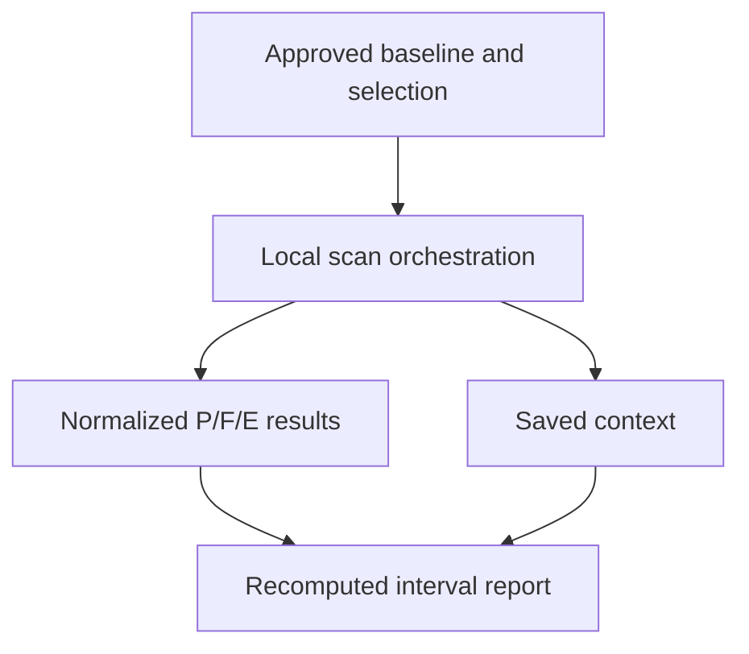
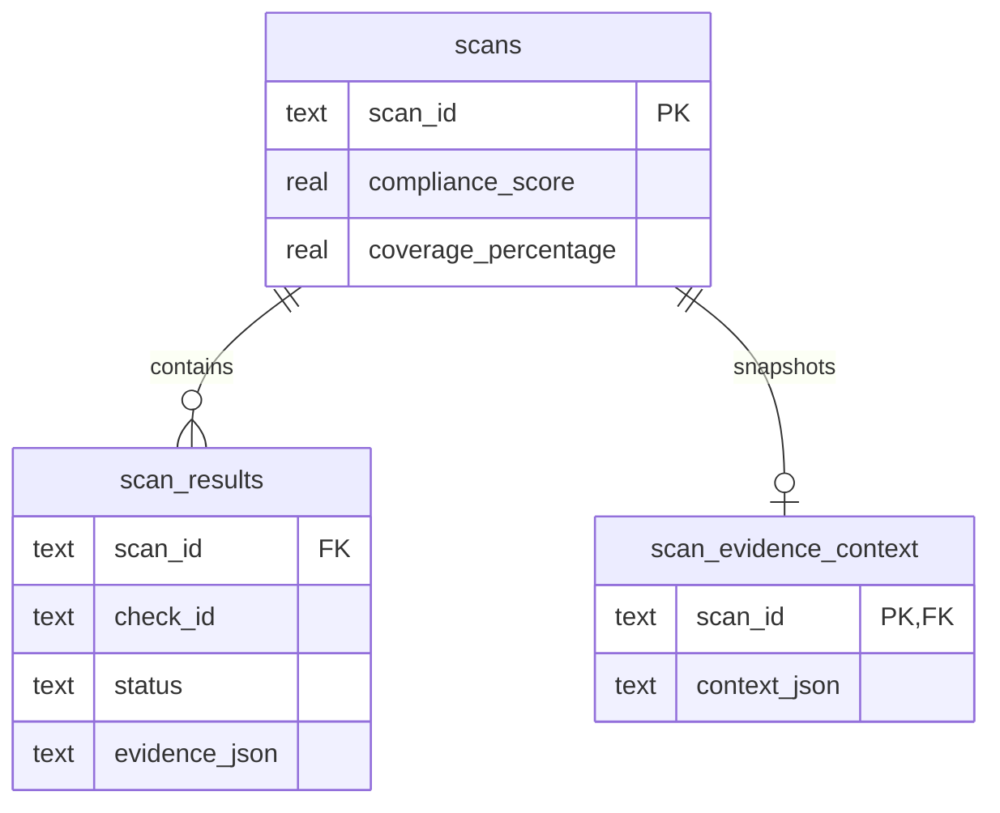

# Milestone 6 research evidence guide

## Evidence to retain

1. Commit identifier and diff for `core/evidence.py`, application wiring,
   SQLite context table, HTML report, and Windows capture runner.
2. Actual pytest output with platform, Python/pytest versions, passed and skipped
   counts. Preserve skips rather than presenting them as passed Windows tests.
3. `research/results/summary.json`, all CSV files, and SHA-256 manifest from the
   same enumeration run. Label them computational model results.
4. Screenshot of a saved HTML report with baseline coverage, interval, threshold,
   label, omitted IDs, baseline version, and digest visible.
5. A reopened historical report showing the same stored baseline. Older scans
   must not gain an inferred baseline from the current catalog.
6. Real Windows capture bundles for each completed case in the lab protocol,
   completed reviewer CSV, corroborating interface records, and final hashes.

## Commands

```powershell
git rev-parse HEAD
python --version
python -m pytest --version
python -m pytest -q
python research/run_study.py
python tools/validate_windows.py --case-id baseline-admin --snapshot-id YOUR_SNAPSHOT --output lab-results/baseline-admin
```

## What each item can establish

- Enumeration and production-module oracle tests support the exact classifier
  under the binary completion model, not field prevalence or collector accuracy.
- Database/report tests support snapshot persistence, escaped rendering, and
  backward compatibility, not resistance to a malicious database/host.
- Real Windows reviewed cases can support exact-objective agreements on the
  executed configurations, with shared native API limitations made explicit.
- Faculty feedback can improve interpretation and presentation, but is not
  independent peer review or publication acceptance.

## Report writing

Keep synthetic finite-state results separate from actual Windows cases. Identify
the experiment denominator every time a percentage is shown. Use illustrative
threshold language. Preserve Error and Omitted counts and never describe the
five-check baseline as complete organizational compliance. Cite the exact
repository commit for reproducibility. Use only genuine screenshots and logs.

## Availability and screenshots

| Evidence | Availability | Suggested capture |
| --- | --- | --- |
| Enumeration CSV/JSON | Available now | `m6-enumeration-summary.png`, actual console output |
| Linux test result | Available now | `m6-linux-tests.png`, 108 passed / 4 skipped |
| Windows execution tests | Not available yet | `m6-windows-tests.png`, actual Windows console |
| Saved interval report | Should be recreated cleanly | `m6-html-interval.png`, context and interval visible |
| Native reference plus scanner state | Not available yet | `m6-case-CHECK-repeat-N.png`, exact objective and time |
| Packaged EXE on a clean VM | Needed after the demo | `m6-clean-exe.png`, build and runtime environment |

Capture the HTML opened from an actual saved scan, not a manually edited
percentage. Redact host identifiers and account names where necessary without
removing state, timestamp, baseline membership, or version evidence. Never
include recovery passwords, tokens, or credentials.

## Architecture and database





Focused algorithm excerpt from `core/evidence.py`:

```python
lower, upper = Fraction(p, n), Fraction(p + e + o, n)
decision = "ABOVE" if lower >= threshold else "BELOW" if upper < threshold else "UNRESOLVED"
```

## Metrics, experiments, and remaining evaluation

RQ1 concerns unsupported assessed-rate conclusions. RQ2 concerns exact
classification against all completions. RQ3 concerns selective scope and the
retained baseline. The threshold examples are 60%, 80%, and 100%. Report P/F/E/O,
N/S, assessed rate, both coverages, both bounds, and the resulting label.

`test_all_1023_vectors_against_binary_completion_oracle` is the main production
model test. The snapshot round-trip and migration tests establish historical
denominator retention and old-record behavior. Escaping tests check that text
fields cannot become report markup. The mocked capture test proves the output
files and HTML can be generated, not that any Windows state was observed.

Ground-truth preparation, repeat counts, standard-user/admin comparisons, and
per-check objectives are in RESEARCH_VALIDATION.md. Accuracy and performance
measurements are unavailable. Do not invent latency, speedup, or accuracy
tables. An eventual timing study must control hardware, warm-up, repeated
execution, and collection scope. An assessor study needs a separate design.

Threats to validity include correct-P/F assumptions, missing dependencies,
generated combinations that may be infeasible on Windows, equal weights,
limited catalog scope, shared APIs in reference capture, and lack of usability
evaluation. A complete five-check report cannot establish organizational
compliance. These are limitations of inference, not evidence of tested failures.

- [x] Generated model data labeled clearly.
- [x] Actual local test counts retained with skips.
- [x] Code and baseline context traceable through local Git history.
- [ ] Controlled real Windows cases independently reviewed.
- [ ] Clean deployment and EXE evidence collected.
- [ ] Performance or usability study executed before making benefit claims.
- [ ] Final manuscript approved by faculty and all authors.
